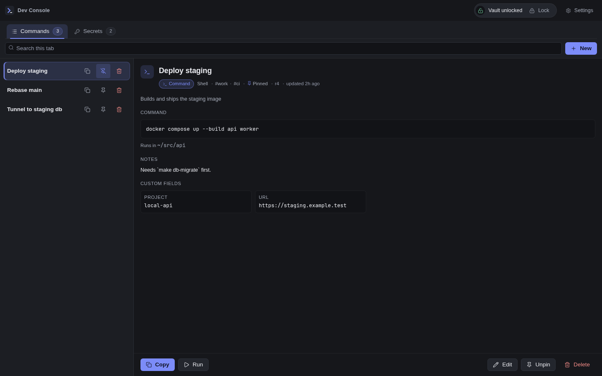
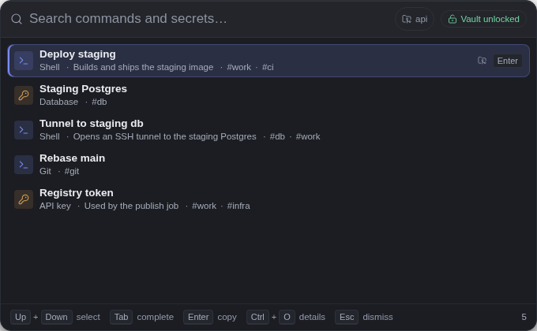
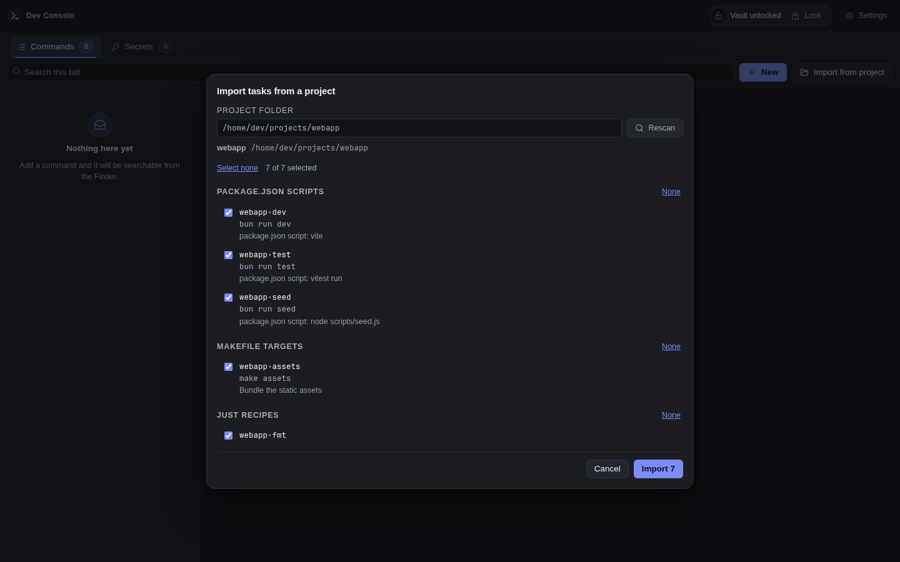

<div align="center">
  
  <h1>Dev Console</h1>
  <p><strong>Your commands and secrets, one shortcut away.</strong></p>
  <p>A local desktop library for the shell commands, credentials, and project tasks you use every day.</p>
  <p>
    <a href="https://github.com/First-Principle-Lab/dev-console/releases/latest">Download for Linux</a>
    &nbsp;·&nbsp;
    <a href="#get-started">Get started</a>
    &nbsp;·&nbsp;
    <a href="docs/README.md">Documentation</a>
    &nbsp;·&nbsp;
    <a href="https://github.com/First-Principle-Lab/dev-console/issues">Report an issue</a>
  </p>
</div>



Save a command once. Find it from anywhere, copy it, or run it in the right project folder.
Keep API keys and credentials in an encrypted vault alongside your command library.

Built for Linux desktops on X11 and Wayland, tested on Hyprland. No account, telemetry,
cloud storage, or remote sync.

## Find it without leaving your workflow

Open Finder with your desktop shortcut, type a name, and press **Enter** to copy.
Search commands and unlocked secrets together, complete names with **Tab**, or jump
to the Library with **Ctrl+O**.

On Hyprland, Finder can detect the project behind your focused terminal and rank its
commands first. Ignore the detected project for one search with **Ctrl+P**, or turn
context detection off in Settings.

<p align="center">
  
</p>

## A library that remembers the details

| Capability | What you can do |
| --- | --- |
| Commands | Save shell commands with working folders, tags, notes, and custom fields. Pin frequent entries and browse by project. |
| Encrypted secrets | Store credentials in an age-encrypted vault backed by your desktop's Secret Service. Reveal values only when you ask. |
| Command execution | Approve and run commands, then inspect stdout, stderr, and exit status. Commands requiring `sudo` open your configured terminal. |
| Project tasks | Import package scripts, Make targets, just recipes, and Docker Compose services without retyping them. |
| History suggestions | Use optional zsh tracking to turn frequently used project commands into saved entries. Review each suggestion before saving. |
| Environment history | Keep encrypted local versions of project `.env` files and copy an earlier version when you need it. |
| Backups | Create encrypted exports and restore reviewed archives. Automatic backups keep the newest eight archives. |
| Themes | Choose light, dark, system appearance, or one of 22 included Omarchy themes. |

### Bring your project's tasks with you

Choose **Import from project**, select a folder, and review the discovered tasks.
Dev Console groups tasks by source and marks commands you have already saved.
Importing saves commands without running them.



<sub>Screenshots show the application UI with synthetic demo data. Secret values are masked.</sub>

## Get started

### Download the AppImage

Download **Dev-Console.AppImage** from the [latest release](https://github.com/First-Principle-Lab/dev-console/releases/latest),
then make it executable and launch it:

```bash
chmod +x Dev-Console.AppImage
./Dev-Console.AppImage
```

The AppImage supports signed in-app updates. When a newer release is available,
choose **Update to x.y.z** to install it and relaunch.

For clipboard support, install `wl-clipboard` on Wayland or `xclip` on X11.
Secret storage needs a running Secret Service provider, such as gnome-keyring or
KWallet. Authenticated vault unlock also needs the installed polkit policy and helper.
See the [installation guide](docs/packaging/packaging.md) for desktop integration.

### Build and install on Arch Linux

With Bun, Rust, and the Tauri Linux build dependencies installed:

```bash
git clone https://github.com/First-Principle-Lab/dev-console.git
cd dev-console
bun install --frozen-lockfile
bunx tauri build --no-bundle
sudo PREFIX=/usr/local bash packaging/install.sh install
dev-console
```

The installer adds the executable, desktop launcher, icons, polkit policy, and unlock
helper. See [packaging and desktop integration](docs/packaging/packaging.md) for package
builds and uninstall instructions. Package and source installations use their own
update process rather than the AppImage updater.

### Set your Finder shortcut

Bind **Super+F**, or your preferred shortcut, to:

```bash
dev-console --finder
```

On Wayland, configure this in your compositor or desktop's shortcut settings. The
command toggles Finder in the running instance. If you use the AppImage directly,
bind the command to its absolute path followed by `--finder`.

### Save your first entry

1. Open the Library and choose **New** in Commands or Secrets.
2. Give the entry a name, enter its value, and save it. Commands can also have a project folder.
3. Open Finder, search for the entry, and press **Enter** to copy it.

To enable project history and automatic environment discovery in new zsh terminals:

```bash
dev-console history setup
```

This backs up `.zshrc` and adds the shell integration. Open a new terminal afterward.
Environment capture requires the app to be running and the vault to be unlocked.
Read more about [project commands](docs/project/project-command-groups.md) and
[environment history](docs/project/project-environments.md).

## Keyboard shortcuts

| Where | Shortcut | Action |
| --- | --- | --- |
| Desktop | Your configured shortcut | Toggle Finder |
| Finder | `↑` / `↓` | Select a result |
| Finder | `Tab` | Complete the selected name |
| Finder | `Enter` | Copy the selected value |
| Finder | `Ctrl+O` | Open the entry in the Library |
| Finder | `Ctrl+P` | Ignore the detected project for this search |
| Finder | `Esc` | Dismiss Finder |
| Library | `Ctrl+1` / `Ctrl+2` | Switch Commands and Secrets |
| Library | `Ctrl+N` | Create an entry |
| Editor | `Ctrl+S` | Save |
| Dialogs | `Esc` | Dismiss or cancel |

## Your data stays local

Commands live in SQLite. Secrets and environment snapshots live in an age-encrypted
vault whose key is stored in your OS keyring. Encrypted exports include the command
library and vault. Default data lives under `~/.local/share/dev-console`, with XDG
directory overrides supported.

Manually locking the vault persists across restarts. Clearing that lock requires
successful system authentication and vault decryption. Without a usable keyring,
commands remain available and secret features report their unavailable state.

Copied values expire after your configured interval, 30 seconds by default.
Clipboard managers may retain their own copies; expiry cannot erase those histories.
Locking your desktop session does not automatically lock the vault. You can connect
`dev-console vault lock` to your screen-lock workflow.

## Development

The current application uses **Tauri 2, Rust, and Svelte 5**, with Bun for the frontend toolchain.
The [Rune migration plan](docs/plans/rune-migration.md) describes a future rewrite.

```bash
bun install --frozen-lockfile
bun run tauri dev
```

Run the full verification gate with:

```bash
bun run verify
```

The gate covers frontend checks, unit and browser tests, Rust checks, and native
integration tests. A missing native test environment reports **UNVERIFIED**, not a pass.

- [Development and verification](docs/project/development-guide.md)
- [Documentation index](docs/README.md)
- [Acceptance criteria and test evidence](docs/project/TEST_REPORT.md)
- [Contribution and release workflow](AGENTS.md)
- [Changelog](CHANGELOG.md)
