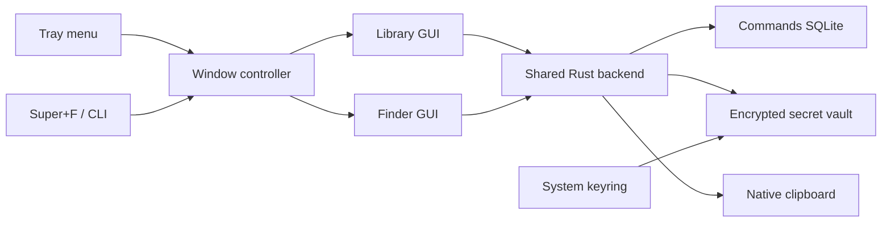

# Dev Console design and implementation

This is the implementation specification for the plan. Code blocks describe the intended implementation; they are not an installed application. Build an Arch/Hyprland release first, then adapt native integrations for other desktops.

## Two interfaces, one application

The Rust application stays alive in the tray. The library and finder are separate Svelte webviews served from the same bundled frontend. They call one Rust backend; neither window owns the database or vault credential.



Keep the finder created and hidden for fast reuse. Create the library on first use and keep it hidden after closing. Both retain only the frontend state they need. Measure the memory cost of retaining both webviews before deciding whether to destroy the hidden library after idle time; unsaved forms must never disappear.

## Library screen

Use a conventional desktop utility layout with an opaque background, restrained borders, a system UI font, and monospace only for commands/values. Follow light/dark desktop preference, with a setting to override it. Avoid decorative animation and blur. Start at about 1040 by 700 logical pixels and permit resizing down to 760 by 520; at narrower widths show list or details rather than squeeze both.

```text
Dev Console                                  Vault unlocked   Settings
Commands   Secrets                          Search this tab   + Add
---------------------------------------------------------------------
Entry list, about 320px wide   | Selected entry
                              | Name                 Type
Docker cleanup       Docker   | Tags                 Description
Git undo commit      Git      | Command / masked secret value
Project tests        Node     | Notes
                              | Extra information
                              |   Project   local-api
                              |   URL       https://example.test
                              | + Add field
                              |
                              | Copy   Edit   Pin   Run*   Delete
---------------------------------------------------------------------
* Run appears only for commands.
```

Commands and Secrets are the only primary tabs. Search and type/tag filters apply to the active tab. A global Open finder action provides combined search. Show the vault status in the header and place a Lock action beside it.

Clicking an entry opens a read-only details panel. Edit uses the same panel with labeled inputs and explicit Save/Cancel buttons. New entry selects the correct tab and opens an empty form. In edit mode, Copy and Run use the saved record only after the draft is saved or discarded, avoiding ambiguous execution of unsaved changes. Ctrl+N creates an entry in the current tab, Ctrl+S saves a valid draft, and Ctrl+1/Ctrl+2 switches tabs. Ordinary Tab/Shift+Tab moves between form controls.

Required fields are name, type, and command text or secret value. Type is a free-entry combobox that suggests existing types for that kind. Tags accept multiple values. Notes are plain multiline text. Custom fields have label, value, display kind, and Move up/Move down/Remove actions. Display kinds are text, multiline text, and URL. Open URL is deliberate and accepts only validated HTTP/HTTPS URLs; do not render arbitrary HTML or run content from custom fields.

On Save, validate in Rust as well as the frontend, persist the complete record atomically, then publish a change event. Keep the draft if saving fails. Deletion asks for confirmation with the entry's name and commits before removing the row. Show empty, locked, loading, and write-error states explicitly. Opening the Secrets tab while locked shows an unlock panel instead of cached entries.

## Finder screen

Use a separate opaque floating window, approximately 680px wide and no more than 520px tall, with about eight results visible and a scrolling list. Use no native titlebar, no resize controls, and no taskbar entry where supported. The compositor controls placement and focus on Wayland; verify that the finder appears on the active monitor and workspace rather than relying on window positioning APIs alone.

```text
Search commands and secrets...                     Vault unlocked
-----------------------------------------------------------------
> Docker cleanup                    Command       Docker
  Docker registry token             Secret        API key
  Restart containers                Command       Docker
-----------------------------------------------------------------
Tab complete   Up/Down select   Enter copy   Ctrl+O details   Esc close
```

The input holds the actual query and the selected entry's remaining prefix is displayed as a muted completion. Keep focus in the input while Up/Down changes the active result. Use the accessible combobox/listbox pattern, stable IDs, and `aria-activedescendant`; the list must not steal focus. Respect IME composition and leave caret editing keys intact. Click selects a row, while a visible Copy action activates it.

Keyboard behavior:

| Key | Action |
| --- | --- |
| Up / Down | Move through results and scroll selected row into view |
| Tab | Complete the selected name; never copy or execute |
| Enter | Copy the selected saved command or secret and hide only after success |
| Ctrl+O | Open the selected entry in the library and hide finder |
| Escape | Hide finder and clear query, selection, and completion |
| Super+F | Show finder if hidden, hide if visible |

With no results, Tab and Enter do nothing. For duplicate names, retain the stable selected entry ID after completion so Enter copies the intended record. New query text selects the best result; asynchronous responses carry request IDs so older searches cannot replace newer results. Reopening starts with a fresh query and suggestions, not the previous secret search.

Search only metadata by default: name, type, tags, and description. Index command metadata from SQLite and secret metadata in Rust memory while unlocked. No secret values are searched. Return at most 50 metadata results with name, kind, type, description, ID, and optional completion. Use deterministic match tiers, then favorite/recent-use tie breaks. Treat this as local ranking, without an AI service or network lookup. Do not issue a database scan of full notes for each keystroke.

Hide the finder on loss of focus unless an app-owned menu, dialog, or details handoff is active. Copy errors keep it open and show a short error without including the secret. On lock, invalidate in-flight requests and clear all secret result metadata from both windows.

## Tray and startup

Create the tray in Rust using `tauri::tray::TrayIconBuilder` and the `tray-icon` Cargo feature. Build a native menu with stable action IDs:

```text
Open library
Open finder
Add command
Add secret
----------------
Lock vault / Unlock vault
Settings
----------------
Quit
```

Route menu events to `WindowController` and `VaultService`. Use a non-secret icon and a tooltip containing only app name and lock status. Linux raw tray click events are unsupported by Tauri, so the context menu must provide every action. The existing Waybar tray/expander should host the icon without a new bar module. If the tray is hidden by a desktop configuration, the application-menu entry and CLI still open the library.

Use a desktop entry for ordinary launches and a separate user autostart entry invoking `dev-console --background`. Enable/disable autostart from Settings. Start at login is opt-in. Intercept the library CloseRequested event to hide after resolving a dirty draft. Let Finder close requests hide it. Handle an explicit Quit path separately to terminate the app after flushing writes and releasing secrets.

Use the single-instance plugin first in Tauri initialization. Parse launch intent before opening windows:

| Invocation | Behavior |
| --- | --- |
| `dev-console` or `dev-console --library` | Open/focus library |
| `dev-console --background` | Start resident without showing a window |
| `dev-console --finder` | Toggle finder in the existing instance |
| `dev-console vault lock` | Lock and acknowledge completion without opening a GUI |
| `dev-console vault unlock` | Request system-authenticated unlock |
| `dev-console vault status` | Print locked/unlocked/unavailable without secret data |

The single-instance callback forwards launch intent but is not by itself a reliable CLI response channel. Implement a small Linux session D-Bus control API for lock/unlock/status acknowledgements. Do not accept secret values over that interface. When no app is running, lock can persist the lock flag without opening the vault; status reads the flag and reports the process state. Unlock launches the backend and its authentication flow. Enforce the same vault checks for GUI and CLI requests.

## Data contracts and storage

Use one discriminated TypeScript model for editor state, but separate metadata search results from records containing values:

```ts
type ExtraField = {
  id: string;
  label: string;
  value: string;
  display: 'text' | 'multiline' | 'url';
};

type EntryBase = {
  id: string;
  revision: number;
  name: string;
  type: string;
  tags: string[];
  description: string;
  notes: string;
  fields: ExtraField[];
  pinned: boolean;
  createdAt: string;
  updatedAt: string;
};

type CommandEntry = EntryBase & {
  kind: 'command';
  command: string;
  workingDirectory?: string;
};

type SecretEntry = EntryBase & { kind: 'secret'; value: string };

type SearchResult = {
  id: string;
  kind: 'command' | 'secret';
  name: string;
  type: string;
  description: string;
  completion?: string;
};
```

The secret editor may receive a value only for explicit reveal/edit while unlocked. Normal inspection returns metadata and a masked-value indicator. Save acknowledgements and change events contain no secret value. Clear editor value state when hidden, locked, or cancelled. Use record revisions to reject stale saves rather than overwrite a newer edit.

SQLite stores command rows, command usage, and schema version. Ordered custom fields and tags can be validated JSON columns initially; foreign-key tables are unnecessary until query requirements justify them. A Rust repository owns SQL and migrations. Bound parameters handle all user text.

The vault stores each complete secret record and its usage as encrypted data. A random credential resides in the system keyring. Only nonsensitive state such as the manual lock flag and interface preferences is outside the vault. Keep type suggestions for secret records inside vault state too.

Resolve directories with Tauri's application data/config APIs. On Linux, respect XDG locations, use user-only permissions, migrate database versions, and persist vault changes with the storage library's documented atomic procedure. Avoid arbitrary filesystem access from the webviews.

The exact vault library and manual-authentication mechanism remain implementation gates. Verify Stronghold's native credential API and persistence semantics before adopting it. A keyring read while the keyring is already unlocked cannot prove the person requesting manual unlock has authenticated. Do not implement a fake secure lock by hiding the interface. See the security rules in PLAN.md.

## Backend commands and synchronization

Expose a small set of typed Tauri commands and scope each to the window that needs it:

| Command | Responsibility |
| --- | --- |
| `search_entries(query, request_id)` | Return metadata results and vault generation |
| `list_entries(kind, filters)` | Browse the current tab without secret values |
| `get_entry(id)` | Return details; omit secret value |
| `reveal_secret(id)` | Return value only after explicit action and backend unlock check |
| `save_entry(draft, expected_revision)` | Validate and persist an entry |
| `delete_entry(id, expected_revision)` | Delete the intended saved revision |
| `copy_entry(id, expected_revision)` | Resolve saved value natively and copy |
| `run_command(id, expected_revision)` | Run an explicitly selected saved command |
| `lock_vault()` / `unlock_vault()` | Change shared vault state |
| `open_library(entry_id?)` | Show library, choose tab, select entry |
| `get_settings()` / `save_settings()` | Manage app settings |

Finder capabilities permit searching, copying, opening details, and requesting unlock. Editing, deletion, reveal, and execution are restricted to library capabilities. Define custom command permissions and validate the calling window in Rust; restrictions must not rely on hidden frontend buttons.

Emit `entries-changed` with affected kind, ID, revision, and vault generation; emit `vault-state-changed` with nonsensitive state. Receivers refetch from the backend. Never broadcast a full secret record. Subscribe before the initial fetch, retain unsubscribe callbacks, and discard responses from older vault generations.

Serialize vault mutations and locking so a lock cannot race with copy/reveal. Recheck access before completing a secret action. Persist before sending success. Reset command execution confirmation when command text or working directory changes. Invoke the configured terminal with argument arrays; never build a shell command by concatenating names, descriptions, or tags. The command body is intentionally shell code, executed only through the explicit Run action.

## Proposed source structure

```text
src/
  App.svelte                 choose library or finder route
  windows/Library.svelte
  windows/Finder.svelte
  components/EntryList.svelte
  components/EntryDetails.svelte
  components/EntryEditor.svelte
  components/ExtraFields.svelte
  components/ResultRow.svelte
  components/VaultStatus.svelte
  lib/models.ts
  lib/api.ts                 typed invoke wrappers
  lib/events.ts
  lib/finder-state.ts         selection and completion behavior
  styles/tokens.css
crates/dev-console-core/src/
  state.rs                   shared AppState
  repository.rs              SQLite and migrations
  vault.rs                   encryption and lock lifecycle
  keyring.rs                 Secret Service adapter
  auth.rs                    verified native authentication adapter
  search.rs                  shared metadata ranking
  clipboard.rs               copy, exclusion, conditional expiry
  execution.rs               terminal execution
  backup.rs                  sealed archives and recovery journal support
  services/mod.rs            the two surfaces a UI may call, and the Effects they return
  services/library.rs        the privileged surface (everything the library window may do)
  services/finder.rs         the palette surface (no reveal, edit, execute, archive, recovery)
src-tauri/src/
  lib.rs                     application setup
  windows.rs                 show/hide/focus, launch intent, relaunch
  tray.rs                    native menu
  ipc.rs                     one adapter per command: guard the window, call the service
  effects.rs                 the single place an event is emitted or a window action performed
  control.rs                 CLI response channel
src-tauri/capabilities/
  finder.json
  library.json
```

## Hyprland integration

Install the built binary before changing bindings. Back up the user's configuration, then append an unbind and a binding to the user-owned bindings file:

```ini
# Super+F previously controlled fullscreen.
unbind = SUPER, F
bindd = SUPER, F, Dev Console finder, exec, dev-console --finder
```

Use the current official Hyprland window-rule syntax to make only the finder float, appear on the invoking workspace/monitor, and use the requested size. Give its window a distinguishable title or class so rules do not affect the library. Resolve the active monitor through a Hyprland adapter when necessary. Do not add a separate Walker/wofi configuration. Run `hyprctl reload` and `hyprctl configerrors` after applying the integration and verify the actual shortcut.

## Implementation stages

1. Scaffold Tauri/Svelte/TypeScript, create both routes, install the single-instance plugin, and implement tray/menu/close behavior with temporary sample entries.
2. Add shared models, command SQLite storage, library browsing and forms, optional custom fields, and change events. Verify save/edit/delete/restart behavior.
3. Implement finder ranking, keyboard selection/completion, copy, and opening the selected library entry. Test duplicate names, stale responses, empty results, and IME input.
4. Verify the active keyring and manual authentication mechanism, then add the encrypted vault, startup unlock, persistent manual lock, metadata search, and secret forms. Verify encryption and lock races before storing real secrets.
5. Add clipboard-history exclusion and expiration, explicit command execution, encrypted backup/restore, settings, and optional autostart.
6. Build a release binary, integrate Super+F, and verify Waybar tray, active-monitor placement, focus, session lock/suspend, startup time, and idle memory on this machine.

The app is complete when both interfaces manage the same entries, all accepted keyboard actions work, manual locking survives restart, and the security and desktop acceptance checks in PLAN.md pass. A tray icon alone or a browser-only mockup does not satisfy the desktop requirement.

## Sources

- [Tauri system tray and Linux event limitations](https://v2.tauri.app/learn/system-tray/)
- [Tauri window customization](https://v2.tauri.app/learn/window-customization/)
- [Tauri single-instance behavior](https://v2.tauri.app/plugin/single-instance/)
- [Tauri Stronghold integration](https://v2.tauri.app/plugin/stronghold/)
- [Linux Secret Service API](https://gnome.pages.gitlab.gnome.org/libsecret/class.Service.html)
